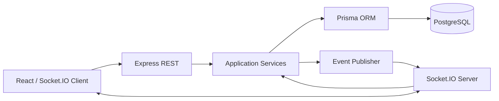
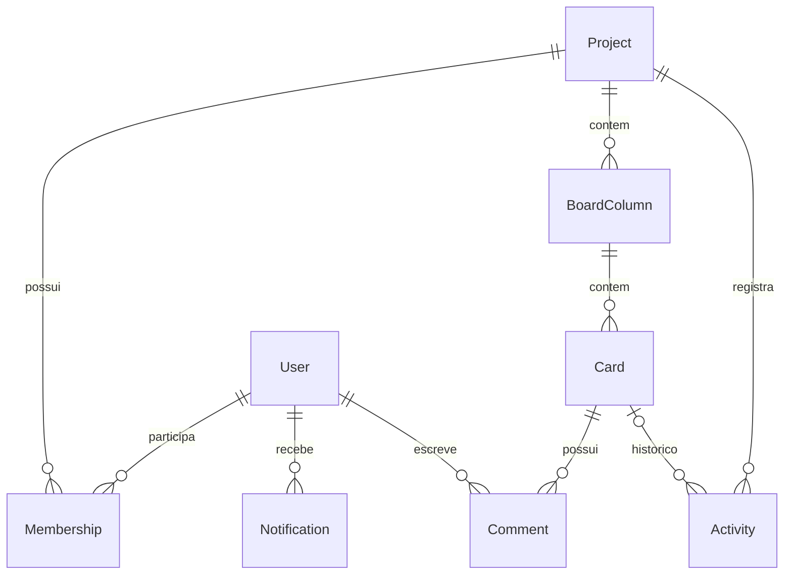

# Arquitetura

## Visão geral

## Camadas
- `domain`: erros e regras independentes de transporte.
- `application`: casos de uso (`moveCard`, `notifyComment`), controle de acesso e publicação de eventos.
- `adapters/http`: rotas REST, JWT e validação Zod.
- `adapters/websocket`: salas, autenticação, validação e eventos Socket.IO.
- `config`: acesso ao banco Prisma.

## Padrões de projeto
1. **Repository / Data Mapper (Prisma)**: persistência encapsulada pelo cliente ORM, sem SQL nos controladores.
2. **Observer / Publish-Subscribe**: `publish()` desacopla casos de uso do Socket.IO; listeners recebem eventos por sala.
3. **Service Layer**: `application/service.js` centraliza regras compartilhadas por HTTP e WebSocket, evitando duplicação.
4. **Adapter**: HTTP e WebSocket traduzem solicitações para os mesmos serviços.

## Modelo de dados

## Segurança e consistência
- JWT na API e no handshake Socket.IO; autorização por vínculo com o projeto.
- Zod valida entrada REST e WebSocket; o servidor controla a associação às salas.
- `moveCard` e `notifyComment` executam gravações relacionadas em transações.
- O cliente reconecta automaticamente e recebe snapshot atualizado ao reentrar.
- O estado durável é PostgreSQL; presença e edição são efêmeros por instância.

## Limites
- Escala horizontal exige adaptador Redis para Socket.IO e presença distribuída.
- `position` é uma posição simples; ordenação fina por drag-and-drop dentro da coluna não foi implementada.
- Não há RBAC granular além de proprietário/membro.
